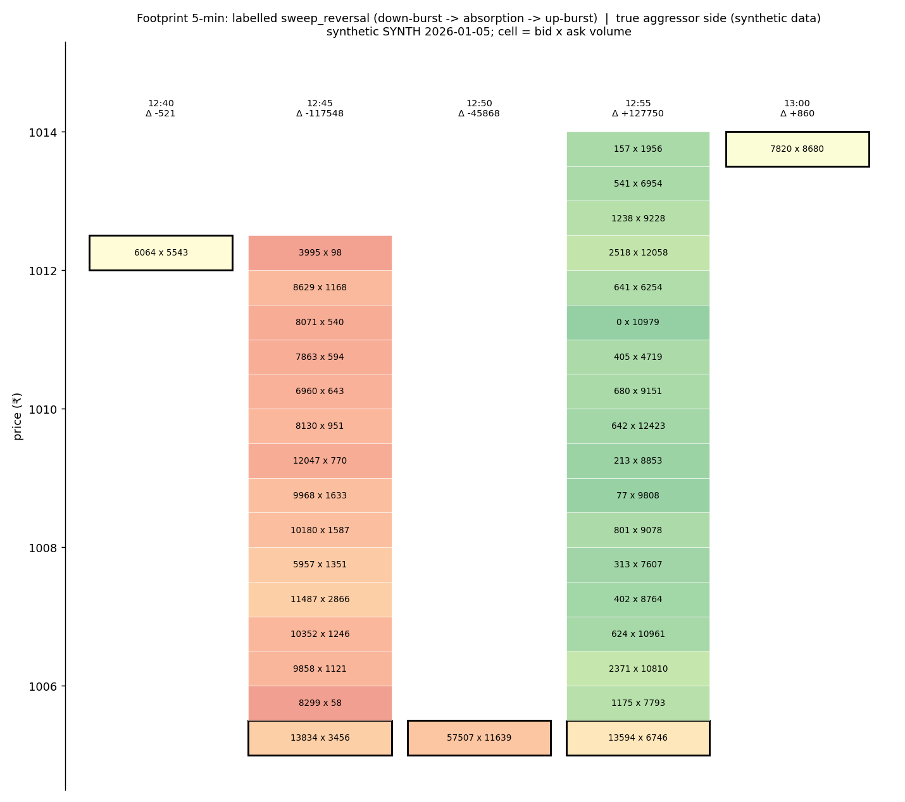

# orderflow-engine

Order flow taught from first principles and applied to real NSE India trades. Sits beside
[`ict-swing-engine`](https://github.com/RakeshDoreswamy/ict-swing-engine) and is meant to confirm or reject its entries.

> **Status: Phases 1 and 2 of 8 done.** Everything below is what exists today. Nothing here has been
> tested on real NSE data yet, and no trading results exist yet.

## Ground rules
- No lookahead; every detector gets a prefix test.
- Anything estimated from coarse data is named `*_est` and charts say "estimated".
- All thresholds, session times, tick sizes and costs live in `config.yaml`.
- Tick size must come from the broker instrument master in real runs (the config value is a synthetic/test fallback).
- Spoofing/layering is market manipulation under SEBI rules: this repo teaches recognition only.

## Phase 1 (done): skeleton, synthetic data, bars/footprint, trade-side classification
| module | what it does |
|---|---|
| `orderflow/config.py` + `config.yaml` | loads all parameters |
| `orderflow/data/synthetic.py` | seeded tick stream with known aggressor side and labelled events: `burst_up`, `absorption_bid`, `absorption_ask`, `sweep_reversal` |
| `orderflow/data/bars.py` | time / tick / volume bars; footprint (price row x bid_vol, ask_vol, trades) |
| `orderflow/classify.py` | tick rule, quote rule, Lee-Ready, accuracy report, label-flip helper for the later stress test |
| `orderflow/viz/footprint_chart.py` | footprint chart |

Run it: `python scripts/phase1_demo.py` (writes `docs/img/footprint_synthetic_sweep.png` and `docs/classifier_accuracy.csv`). Tests: `pytest`.



### Measured: classifier accuracy on synthetic data (17,014 trades, seed 42)
| method | coverage | acc (labelled) | acc (all) | acc (volume-weighted) |
|---|---|---|---|---|
| tick_rule | 0.9999 | 0.9228 | 0.9227 | 0.9361 |
| quote_rule | 0.9993 | 0.9934 | 0.9927 | 0.9947 |
| lee_ready | 1.0000 | 0.9933 | 0.9933 | 0.9953 |

**Caveat:** this is a toy generator where a trade always prints exactly at the bid or ask and the
attached quote is stale 15% of the time (`stale_quote_prob`). Real NSE accuracy will differ and
must be measured on real recorded data (Phase 5). These numbers only show the machinery works.

### Not generated yet
Iceberg refills, exhaustion and pulled spoofs need an order book (Phase 3).

## Phase 2 (done): delta/CVD, footprint analytics, profile/TPO, VWAP
| module | what it does |
|---|---|
| `orderflow/delta.py` | delta, delta %, intrabar max/min, delta at high/low, session and anchored CVD, confirmed swings, CVD divergences (stamped at the confirming bar), delta flips, delta without progress, OHLCV delta estimate |
| `orderflow/footprint.py` | per-bar POC and value area, diagonal and stacked imbalances, finished/unfinished extremes, zero rows |
| `orderflow/profile.py` | volume profile (session / composite / fixed range), value area by expansion, HVN/LVN, shape classifier (P, b, D, thin, double), naked POCs |
| `orderflow/tpo.py` | TPO letters, initial balance, extensions, single prints, poor/excess extremes, open-type heuristic |
| `orderflow/vwap.py` | session and anchored VWAP with sigma bands |
| `orderflow/viz/concepts.py` | one generated visual per concept 1-23 (`python scripts/build_gallery.py`) |

Open `docs/index.html` for the study page (concepts 1-23, each with definition, why it matters, how to read it, common mistakes and a generated visual). Rebuild with `python scripts/build_gallery.py && python scripts/build_site.py`.

### Measured on synthetic data (toy generator; nothing here is evidence about real NSE behaviour)
- CVD divergences found on the seed-42 day: 6 (4 bearish, 2 bullish). Predictive value is untested.
- OHLCV delta estimate vs true bar delta: correlation 0.98 (inflated by a few huge bars) but same sign in only 75% of 75 bars.
- Quote rule accuracy falls from 100% to 98.0% as the share of stale quotes goes 0% to 50%; the tick rule stays at 93.6%.
- Finished highs/lows are rare in the toy model (1.0% / 1.7% of 600 bars, only inside one-sided bursts).
- Open types on 8 synthetic days: {'open_auction': 8}. The toy market has no opening structure; the rules are verified on hand-built paths in the unit tests.

### Known limits / not done
- Concepts 16 (absorption) and 17 (trapped traders) are visualised on generator-labelled events; the detectors are Phase 3.
- The 80% value-area rule and gap-fill tendencies are listed as hypotheses; their test harness is Phase 6.
- Golden-image tests for charts are not written yet (smoke tests check each chart renders).
- One study page with 23 concept sections; the planned 41 separate pages come in Phase 8.

## Roadmap
3 book + events | 4 EOD providers + swingflow |
5 live recorder | 6 setups + backtest | 7 ICT bridge, Pine, Actions | 8 learning site.

## Setup
```
python3 -m venv .venv && source .venv/bin/activate
pip install pandas numpy pyarrow matplotlib pyyaml pytest
pytest
```
Targets Python 3.11; developed and tested on 3.10 so far. Copy `.env.example` to `.env` for broker credentials (Phase 5; git-ignored).

## Phase 3 results: book analytics and event detectors (synthetic data)

Detectors: `orderflow/book.py` (depth imbalance, walls, pull/stack, spoof-like pulls, iceberg refills) and
`orderflow/events.py` (large prints, absorption, exhaustion, trapped traders, delta flip). Scored by
`scripts/phase3_eval.py` against the labels the generator planted.

**Protocol.** Thresholds were tuned only on 12 calibration days (seed base 500). The table below is 20 held-out
days (seed base 9000), run once, no tuning afterwards. Recall = labelled events with a detection inside
[start, end + 2 min]. Precision = detection episodes overlapping a labelled window. Intervals are Wilson 95%.

| detector | labelled | found | recall | recall_ci95 | detections | true_pos | precision | precision_ci95 | note |
|---|---|---|---|---|---|---|---|---|---|
| large_print | 100 | 89 | 0.89 | 0.81-0.94 | 154 | 89 | 0.58 | 0.50-0.65 |  |
| absorption | 21 | 21 | 1.00 | 0.85-1.00 | 53 | 53 | 1.00 | 0.93-1.00 |  |
| iceberg | 19 | 11 | 0.58 | 0.36-0.77 | 11 | 11 | 1.00 | 0.74-1.00 | small sample |
| exhaustion | 16 | 16 | 1.00 | 0.81-1.00 | 23 | 20 | 0.87 | 0.68-0.95 | small sample |
| trapped | 11 | 5 | 0.45 | 0.21-0.72 | 8 | 6 | 0.75 | 0.41-0.93 | small sample |
| delta_flip | 11 | 7 | 0.64 | 0.35-0.85 | 40 | 7 | 0.17 | 0.09-0.32 | small sample |
| wall | 18 | 18 | 1.00 | 0.82-1.00 | 351 | 192 | 0.55 | 0.49-0.60 | small sample |
| spoof_like | 174 | 158 | 0.91 | 0.86-0.94 | 344 | 158 | 0.46 | 0.41-0.51 |  |

Raw numbers: `docs/detector_scores.csv`.

**How to read this honestly.**
- The generator and the detectors share one author's mental model. This is a *consistency test* (does each rule find
  what it describes?), not evidence that these rules work on NSE data.
- Large print: the natural size distribution has a heavy tail (99th percentile ~15x the median), so a lower
  threshold fires on ordinary trades. The 30x threshold was picked on calibration days as a recall/precision trade-off.
- Wall precision is ~0.55 and spoof-like ~0.46: the tracker also flags the generator's ordinary deep orders, and a
  wall removed at the end of its window looks like a pull. Spoofing is recognition only, never a trade signal.
- Iceberg, trapped and delta-flip recall are modest, and delta-flip precision is low (~0.17). Treat delta flip as a
  context flag, not a signal.
- Tiny samples are marked "small sample"; their intervals are wide.
